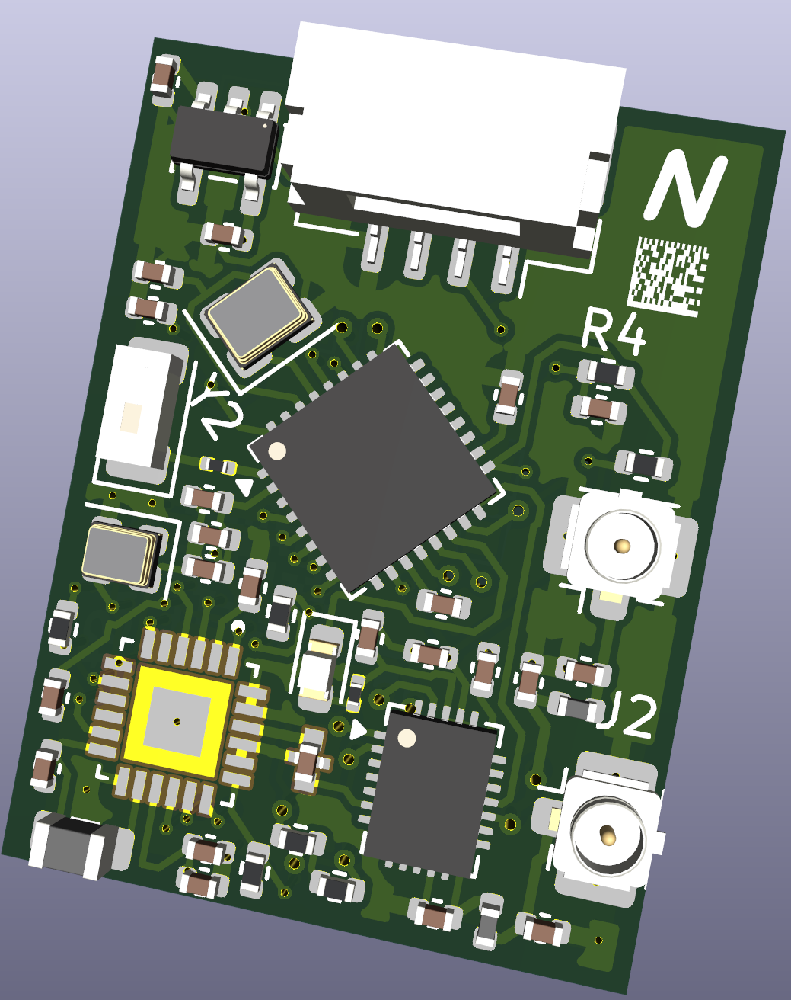
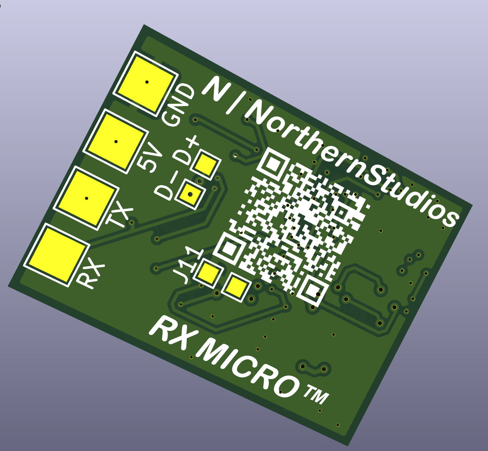
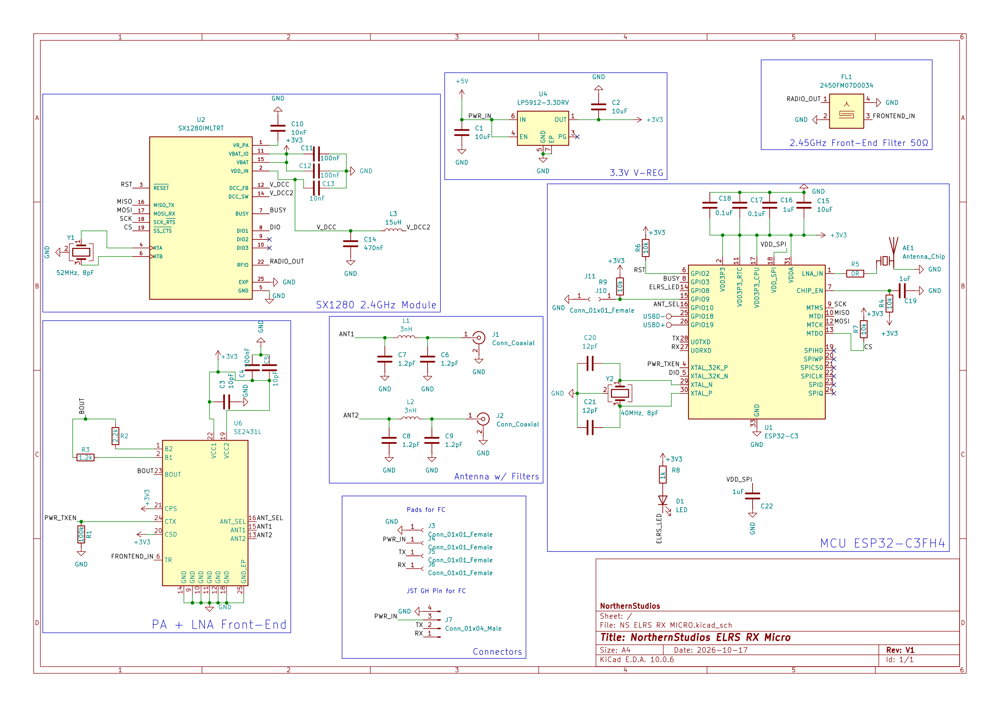
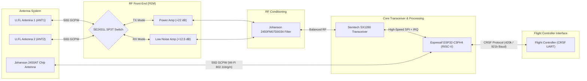
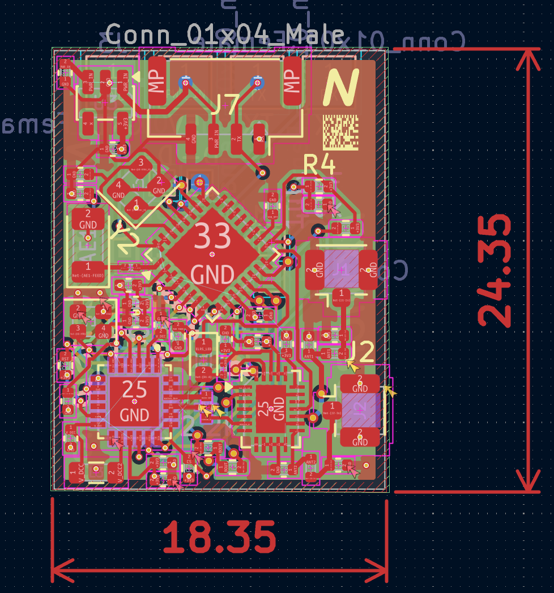

<p align="center">
  <a href="https://www.oshwa.org/"></a>
  <a href="#license--regulatory-compliance"></a>
  <a href="https://www.kicad.org/"></a>
  <a href="https://www.expresslrs.org/"></a>
  <a href="https://jlcpcb.com/"></a>
  <a href="https://www.espressif.com/en/products/socs/esp32-c3"></a>
</p>

<h1 align="center">Nano 2.4 GHz ExpressLRS Diversity PA/LNA Receiver</h1>

<p align="center">
  <strong>An ultra-compact (16×22 mm), open-hardware 2.4 GHz ExpressLRS receiver featuring true antenna diversity, a high-power FEM (+20 dBm telemetry), integrated Wi-Fi ceramic antenna, and paneled breakaway rails for low-cost JLCPCB PCBA.</strong>
</p>

<p align="center">
  <a href="#key-specifications--features">Key Specs</a> •
  <a href="#hero-visuals--3d-views">Visuals</a> •
  <a href="#schematic--system-architecture">Architecture</a> •
  <a href="#hardware-configuration--pinout">Pinout</a> •
  <a href="#pcb-fabrication--stackup-requirements">PCB Stackup</a> •
  <a href="#flashing--firmware-setup">Firmware Setup</a> •
  <a href="#bill-of-materials-bom--sourcing">BOM</a> •
  <a href="#license--regulatory-compliance">License</a>
</p>

---

## 1. Hero Visuals & 3D Views

<p align="center">
  
  <br>
  <em>Figure 1: Production 3D Top Render of the Nano 2.4 GHz ExpressLRS Diversity PA/LNA Receiver</em>
</p>

<details open>
<summary><b>🔍 Detailed 3D Perspective Comparison (Front & Back Views)</b></summary>
<br>

| Front Perspective (Core Silicon & RF Frontend) | Back Perspective (Passives, Testpads & Ground Plane) |
| :---: | :---: |
|  |  |
| **Top Side (L1):** ESP32-C3FH4, Semtech SX1280 Transceiver, Skyworks SE2431L PA/LNA FEM, 2450FM07D0034 Bandpass Filter, dual U.FL IPEX jacks, Johanson 2450AT ceramic chip antenna, status LED, crystals, and JST-GH connector. | **Bottom Side (L4):** Solid thermal relief stitching vias, dedicated USB test pads (USBD+/USBD-), BOOT strapping testpad, and low-impedance RF ground shield flood. |

</details>

---

## 2. Key Specifications & Features

The **NorthernStudios Nano 2.4 GHz ExpressLRS Diversity Receiver** is engineered for long-range, high-reliability UAV control links, telemetry backhaul, and high-interference drone racing / freestyle environments. Combining high-efficiency RISC-V computing with Semtech's SX1280 transceiver and Skyworks' SE2431L front-end module, it provides industrial-grade packet reception sensitivity, +20 dBm (100 mW) telemetry uplink, and seamless over-the-air firmware management.

### Executive Specification Matrix

| Category | Specification | Technical Implementation / Notes |
| :--- | :--- | :--- |
| **Microcontroller (MCU)** | **ESP32-C3FH4** | 32-bit RISC-V single-core @ 160 MHz, 400 KB SRAM, 4 MB embedded SiP SPI flash |
| **RF Transceiver** | **Semtech SX1280IMLTRT** | 2.4 GHz LoRa, FLRC, and high-speed FSK modulation engine (-132 dBm sensitivity) |
| **Front-End Module (FEM)** | **Skyworks SE2431L** | Fully integrated RF front-end: +22 dB PA, +12.5 dB LNA (2.0 dB NF), SP3T RF switch |
| **Telemetry Uplink Power** | **Up to 100 mW (+20 dBm)** | Dynamic/fixed telemetry power configurable via ExpressLRS WebUI and Lua scripts |
| **Primary Antenna Link** | **Dual U.FL / IPEX1 (ANT1 / ANT2)** | True spatial and polarization diversity switched dynamically per-packet |
| **Configuration Link** | **Johanson 2450AT18A100** | Dedicated onboard 2.45 GHz ceramic chip antenna for ESP32 Wi-Fi AP & WebUI |
| **RF Filtering** | **Johanson 2450FM07D0034** | Matched high-rejection 2.4 GHz ceramic bandpass filter / balun |
| **Active PCB Dimensions** | **16.0 × 22.0 mm** | Ultra-lightweight form factor suitable for sub-250g micros and long-range wings |
| **Board Interface Pads** | **2.54 mm Castellated Edges** | 4-pin direct solder pads (`5V`, `GND`, `TX`, `RX`) + sub-miniature test points |
| **Quick-Disconnect Plug** | **JST-GH 4-Pin Horizontal** | Standard 1.25 mm pitch connector for direct drone flight controller wire harness |
| **Panelized Manufacturing** | **70.0 × 70.0 mm Breakaway** | 0.6 mm perforated mouse-bite tabs, optical fiducials, and 3.2 mm tooling holes |
| **Power Input Range** | **4.5 V – 5.5 V DC** | Onboard high-efficiency, low-noise TSOT-23-5 LDO producing clean 3.3 V @ 500 mA |
| **Firmware Ecosystem** | **ExpressLRS v3.x / v4.x** | Custom unified target definition via runtime `hardware.json` or config profiles |

---

## 3. Schematic & Architecture

### System Schematic
The schematic is captured in KiCad 8/9 with complete hierarchical decoupling, controlled RF coplanar waveguides, and low-noise power distribution.

<p align="center">
  
  <br>
  <em>Figure 2: Complete Electrical Schematic — ESP32-C3FH4 Core, SX1280 2.4 GHz Transceiver, SE2431L Front-End Module, and Johanson RF Network</em>
</p>

### Architecture & Signal Flow

The receiver features two independent 2.4 GHz RF paths:
1. **LoRa / FLRC Flight Control Path:** Routes bidirectional RF signals between dual external U.FL dipole/immortal-T antennas, through the SE2431L SP3T switch, through the internal PA/LNA, through the matched 2450FM07D0034 bandpass filter, and into the Semtech SX1280 transceiver.
2. **Wi-Fi WebUI Configuration Path:** Connects the ESP32-C3's internal Wi-Fi/Bluetooth RF transceiver (`LNA_IN`) directly to an onboard Johanson 2450AT ceramic chip antenna through a precision 50Ω Grounded Coplanar Waveguide (GCPW), isolating telemetry link tuning from configuration management.



#### ASCII Architecture Reference
```text
+---------------------------------------------------------------------------------------+
|                                    ANTENNA SYSTEM                                     |
|    [U.FL Port 1]                     [U.FL Port 2]            [Johanson 2450AT Chip]  |
|          |                                 |                             |            |
|          +----------------+----------------+                             |            |
|                           | (50Ω GCPW)                                   | (50Ω GCPW) |
|                           v                                              |            |
|       +---------------------------------------+                          |            |
|       |         Skyworks SE2431L FEM          |                          |            |
|       |  [ANT Switch] <-> [PA / +22dB]        |                          |            |
|       |               <-> [LNA / +12.5dB]     |                          |            |
|       +-------------------+-------------------+                          |            |
|                           ^                                              |            |
|                           | (Tx / Rx Enable & Ant Sel)                   |            |
|                           v                                              |            |
|       +---------------------------------------+                          |            |
|       |     Johanson 2450FM07D0034 Filter     |                          |            |
|       +-------------------+-------------------+                          |            |
|                           | (Matched Differential)                       |            |
|                           v                                              |            |
|       +---------------------------------------+                          |            |
|       |       Semtech SX1280 Transceiver      |                          |            |
|       |        2.4 GHz LoRa / FLRC / FSK      |                          |            |
|       +-------------------+-------------------+                          |            |
|                           |                                              |            |
|                           | SPI Bus (MOSI, MISO, SCK, NSS, BUSY, DIO1)   |            |
|                           v                                              v            |
|       +-----------------------------------------------------------------------+       |
|       |                     Espressif ESP32-C3FH4 Core                        |       |
|       |          32-bit RISC-V @ 160 MHz | 4MB Flash | 2.4 GHz Wi-Fi          |       |
|       +-----------------------------------+-----------------------------------+       |
|                                           |                                           |
|                           CRSF Telemetry  |  CRSF Serial RX                           |
|                           (GPIO20 - TX)   |  (GPIO21 - RX)                            |
|                                           v                                           |
|                         [Flight Controller UART Pad / JST-GH]                         |
+---------------------------------------------------------------------------------------+
```

---

## 4. Hardware Configuration & Pinout

The pin assignment is optimized for optimal trace routing on 4-layer PCBs, preserving signal integrity along high-speed SPI lines while isolating sensitive radio triggers from high-frequency clock harmonics.

### ExpressLRS Hardware Pin Mapping

| ESP32-C3 GPIO | Function / Net | ExpressLRS Definition | Description | Electrical Notes |
| :--- | :--- | :--- | :--- | :--- |
| **GPIO02** | `SX_RST` | `radio_rst` | SX1280 Hardware Reset | Active Low; internal pull-up |
| **GPIO03** | `SX_BUSY` | `radio_busy` | SX1280 Busy Status | Active High; polled before SPI transfers |
| **GPIO04** | `PWR_TXEN` | `power_txen` | SE2431L Transmit Enable | High = PA Transmit Mode; Low = LNA Receive Mode |
| **GPIO05** | `SX_DIO1` | `radio_dio1` | SX1280 Packet Interrupt | Active High; hardware interrupt for RX/TX events |
| **GPIO06** | `SCK` | `radio_sck` | Hardware SPI Clock | Up to 18 MHz SPI master bus clock |
| **GPIO07** | `MISO` | `radio_miso` | Hardware SPI Data In | Master-In Slave-Out from SX1280 |
| **GPIO08** | `ELRS_LED` | `led` | Receiver Status LED | Active Low; tied to 3.3V via current-limit resistor |
| **GPIO09** | `BOOT` | — | ESP32 Strapping / Boot | Pulled High internally; pull to GND for DFU UART flash |
| **GPIO10** | `ANT_SEL` | `ant_ctrl` | SE2431L Antenna Switch | High = Antenna 2 (ANT2); Low = Antenna 1 (ANT1) |
| **GPIO12** | `MOSI` | `radio_mosi` | Hardware SPI Data Out | Master-Out Slave-In to SX1280 |
| **GPIO13** | `SX_NSS` | `radio_nss` | SX1280 Chip Select | Active Low SPI slave select |
| **GPIO20** | `U0RXD` | `serial_tx` | ExpressLRS CRSF TX | Transmits CRSF packet frames to Flight Controller RX |
| **GPIO21** | `U0TXD` | `serial_rx` | ExpressLRS CRSF RX | Receives serial channel/telemetry from Flight Controller TX |

### External Connector & Pad Pinout

```text
       +---------------------------------------------+
       | [ANT1]                               [ANT2] |
       |                                             |
       |  (1) 5V   [ 4.5V - 5.5V DC Input ]          |
       |  (2) GND  [ Power & Signal Ground ]         |  Active PCB Area:
       |  (3) TX   [ CRSF Telemetry to FC RX ]       |  16.0 x 22.0 mm
       |  (4) RX   [ CRSF Control from FC TX ]       |
       |                                             |
       | [JST-GH] (1:GND, 2:5V, 3:TX, 4:RX)          |
       | [TP_BOOT] [TP_USBD-] [TP_USBD+]             |
       +---------------------------------------------+
```

* **Castellated Solder Pads (Edge J3–J6):** Standard 2.54 mm (0.1") pitch for direct wire soldering or header pins.
* **Micro-Connector (J7):** JST-GH 4-pin horizontal locking receptacle (1.25 mm pitch) matching modern flight controllers (Matek, SpeedyBee, Holybro, BetaFPV).
* **Test Points:** Dedicated pads for `BOOT` (J10/J11), `USBD-` (TP1), and `USBD+` (TP2) for debugging or manual recovery.

---

## 5. PCB Fabrication & Stackup Requirements

The board utilizes a 4-layer controlled-impedance stackup specifically tailored for the **JLCPCB JLC04161H-3313** or **JLC04161H-7628** process.

<p align="center">
  
  <br>
  <em>Figure 3: 4-Layer Controlled-Impedance Stackup (0.1 mm Prepreg / 1.6 mm Total Board Thickness)</em>
</p>

### Layer Stack Architecture

| Layer | Type | Copper Thickness | Material | Description & RF Design Rules |
| :--- | :--- | :--- | :--- | :--- |
| **L1 (Top)** | Signal / RF | 1 oz (0.035 mm) | Copper | **High-frequency 50Ω GCPW traces**, critical components, antenna feed lines |
| *Dielectric 1* | Core/Prepreg | 0.100 mm | FR4 (εr ≈ 4.5) | Prepreg layer providing tight capacitive coupling to Layer 2 GND |
| **L2 (Inner 1)** | Plane | 1 oz (0.035 mm) | Copper | **Solid unbroken Ground reference plane**. Zero cutouts under RF traces |
| *Dielectric 2* | Core | 1.240 mm | FR4 (εr ≈ 4.5) | Rigid structural core isolating RF ground from digital power routing |
| **L3 (Inner 2)** | Power / Signal | 1 oz (0.035 mm) | Copper | Clean 3.3V power rails, LDO decoupling, non-critical control signals |
| *Dielectric 3* | Core/Prepreg | 0.100 mm | FR4 (εr ≈ 4.5) | Dielectric insulation layer |
| **L4 (Bottom)** | Signal / Ground | 1 oz (0.035 mm) | Copper | Secondary ground flood, thermal vias, testpoints, and passive return paths |

### RF Coplanar Waveguide Specifications
* **50Ω GCPW Trace Width ($W$):** `0.18 mm` (7.1 mil)
* **Trace-to-Ground Clearance ($S$):** `0.15 mm` (5.9 mil)
* **Dielectric Height ($H$):** `0.10 mm` (Prepreg to Layer 2 GND)
* **Ground Via Pitch:** Continuous via stitching with $\le 1.0\text{ mm}$ center-to-center spacing along all RF microstrips to suppress substrate resonance.

### Panel & Breakaway Frame Handling
The receiver is fabricated in a standardized **70 × 70 mm manufacturing panel frame** containing:
* **Tooling Holes:** 4× 3.2 mm non-plated holes located at panel corners for automated high-speed SMT feeders.
* **Optical Fiducials:** 3× 1.0 mm round copper fiducials with 2.0 mm soldermask openings for machine vision alignment.
* **Breakaway Tabs:** 0.6 mm perforated mouse bites with center drill holes on each breakaway edge.

> [!TIP]
> **Post-Reflow Breakaway Removal Instructions:**
> 1. Score the mouse bite tabs lightly using an engineer's carbide scribe or hobby hobby knife on both sides.
> 2. Support the active receiver body flat against a bench surface and bend the outer rails downward with gentle, even pressure.
> 3. Clip remaining nibs flush using precision flush cutters (e.g. Plato 170).
> 4. Lightly dress the castellated edges with 400-grit abrasive paper to ensure no copper burrs short against the edge ground plane.

---

## 6. Flashing & Firmware Setup

### Method 1: Initial UART Bootloader Flash (First-Time Commissioning)

1. Connect the receiver to a 3.3V USB-to-UART adapter (CP2102, FT232RL, or CH340):
   * `5V` $\rightarrow$ `5V` (or external clean 5V supply)
   * `GND` $\rightarrow$ `GND`
   * `TX` $\rightarrow$ Adapter `RX`
   * `RX` $\rightarrow$ Adapter `TX`
2. **Engage Bootloader:** Bridge the **`BOOT`** test pad (GPIO09) to **`GND`** using tweezers or a jumper wire, then connect USB power to the adapter. Release the bridge after power is applied.
3. Open **ExpressLRS Configurator** (v1.6.0+):
   * **Target:** `Generic target using ESP32-C3` (or choose unified target)
   * **Device:** `Generic ESP32-C3 2.4GHz RX`
   * **Flashing Method:** `UART`
   * Set your **Binding Phrase**, regulatory domain (`FCC` / `LBT`), and Wi-Fi credentials.
4. Click **Build & Flash**. Once flashing is complete, power-cycle the board.

---

### Method 2: Wi-Fi Over-The-Air (OTA) Updating (Recommended)

1. Power the receiver via flight controller or a 5V bench supply.
2. Leave your radio transmitter powered off. After **60 seconds**, the receiver will automatically switch into Wi-Fi Access Point mode.
3. The onboard status LED (`D1`) will begin rapidly blinking (5 Hz).
4. Connect your PC or smartphone to the Wi-Fi network:
   * **SSID:** `ExpressLRS RX`
   * **Password:** `expresslrs`
5. Navigate your browser to `http://10.0.0.1` (or `http://elrs_rx.local`).
6. Upload the updated `.bin` firmware file or modify runtime configuration values directly via the WebUI.

---

### Custom Target Definition (`hardware.json`)

To load the hardware pinout dynamically on unified ExpressLRS firmware builds, navigate to the **Hardware** tab in the WebUI and paste the following target definition:

```json
{
  "target": "NS_ELRS_RX_MICRO_2400",
  "name": "NorthernStudios Nano 2.4GHz Diversity RX",
  "brand": "NorthernStudios",
  "radio": "sx1280",
  "mcu": "esp32c3",
  "serial_rx": 21,
  "serial_tx": 20,
  "radio_busy": 3,
  "radio_dio1": 5,
  "radio_miso": 7,
  "radio_mosi": 12,
  "radio_nss": 13,
  "radio_rst": 2,
  "radio_sck": 6,
  "power_txen": 4,
  "ant_ctrl": 10,
  "led": 8,
  "led_inverted": true,
  "power_min": 0,
  "power_high": 3,
  "power_max": 3,
  "power_default": 0,
  "power_control": 1,
  "power_values": [-18, -13, -9, -5, -2, 0, 3, 6, 10, 13]
}
```

---

## 7. Bill of Materials (BOM) & Sourcing

Every active IC, passive, and connector has been selected for high performance, standard commercial availability, and turnkey automated assembly via JLCPCB SMT / LCSC.

### Core Active Silicon & RF Front-End

| Designator | Value / Part Number | Manufacturer | Description & Package | LCSC Part # | Sourcing Link |
| :--- | :--- | :--- | :--- | :--- | :--- |
| **U1** | **ESP32-C3FH4** | Espressif Systems | 32-bit RISC-V SoC, 4MB Flash, QFN-32 (5×5 mm) | Standard | [Datasheet](https://www.espressif.com/sites/default/files/documentation/esp32-c3_datasheet_en.pdf) |
| **U2** | **SX1280IMLTRT** | Semtech Corp. | 2.4 GHz LoRa/FLRC Transceiver, QFN-24 (4×4 mm) | Standard | [Datasheet](https://www.semtech.com/products/wireless-rf/24-ghz/sx1280) |
| **U6** | **SE2431L-R** | Skyworks Solutions | High-Power FEM (PA + LNA + SP3T Switch), QFN-24 (3×4 mm) | **C2649471** | [Datasheet](https://www.skyworksinc.com/-/media/SkyWorks/Documents/Products/1801-1900/SE2431L_202410L.pdf) |
| **U3** | **SGM2036-3.3** / TSOT23 | SG Micro / Anyleaf | High PSRR, 500mA LDO Regulator, TSOT-23-5 | **C587158** | [LCSC](https://www.lcsc.com/product-detail/Linear-Voltage-Regulators-LDO_SGMICRO-SGM2036-3-3YN5G-TR_C587158.html) |
| **FL1** | **2450FM07D0034** | Johanson Technology | Matched 2.45 GHz Bandpass Filter/Balun, SMD-1109 | Standard | [Johanson](https://www.johansontechnology.com/datasheets/2450FM07D0034/2450FM07D0034.pdf) |
| **AE1** | **2450AT18A100** | Johanson Technology | 2.45 GHz Ceramic Chip Antenna, SMD-3216 (1206) | Standard | [Johanson](https://www.johansontechnology.com/datasheets/antennas/2450AT18A100.pdf) |

### Crystals, Connectors & Passives

| Designator | Quantity | Value / Specification | Footprint / Package | LCSC Part # | Notes |
| :--- | :---: | :--- | :--- | :--- | :--- |
| **Y1** | 1 | **52 MHz, 8 pF, ±10 ppm** | Crystal SMD 2016-4P (2.0×1.6 mm) | Standard | SX1280 Reference Clock |
| **Y2** | 1 | **40 MHz, 8 pF, ±10 ppm** | Crystal SMD 2520-4P (2.5×2.0 mm) | Standard | ESP32-C3 Reference Clock |
| **J1, J2** | 2 | **U.FL-R-SMT-1** (IPEX1) | Micro-Coaxial Surface Mount Jack | Standard | ANT1 / ANT2 RF Connectors |
| **J7** | 1 | **SM04B-GHS-TB (LF)(SN)** | 4-Pin 1.25 mm Horizontal JST-GH | **C189895** | Flight Controller Harness |
| **D1** | 1 | **LED Emerald Green / Blue** | SMD 0603 (1608 Metric) | Standard | Status Indicator (Active Low) |
| **L1, L2** | 2 | **3.0 nH High-Q Inductor** | SMD 0402 (1005 Metric) | Standard | RF Matching Network |
| **L3** | 1 | **15 µH Power Inductor** | SMD 0805 (2012 Metric) | Standard | SX1280 DC-DC Buck Filter |
| **C1** | 1 | **1 µF 10V X5R** | SMD 0402 (1005 Metric) | **C52923** | Decoupling |
| **C2** | 1 | **2.2 µF 10V X5R** | SMD 0402 (1005 Metric) | **C12530** | LDO Output Bypass |
| **C3, C5** | 2 | **10 pF 50V C0G/NP0** | SMD 0402 (1005 Metric) | Standard | RF Decoupling |
| **C6, C7, C8, C9**| 4 | **1.2 pF 50V C0G/NP0** | SMD 0402 (1005 Metric) | Standard | RF Matching / Tuning |
| **C4, C11, C12** | 3 | **100 nF 16V X7R** | SMD 0402 (1005 Metric) | Standard | Digital Decoupling |
| **C10, C13** | 2 | **10 nF 50V X7R** | SMD 0402 (1005 Metric) | Standard | RF Power Rail Decoupling |
| **C14** | 1 | **470 nF 10V X5R** | SMD 0402 (1005 Metric) | Standard | Transceiver VDD |
| **C15** | 1 | **10 µF 10V X5R** | SMD 0402 (1005 Metric) | Standard | LDO Bulk Decoupling |
| **C16, C19, C22**| 3 | **1 µF 10V X5R** | SMD 0402 (1005 Metric) | Standard | Power Rail Smoothing |
| **C17, C18** | 2 | **0.1 µF 16V X7R** | SMD 0402 (1005 Metric) | Standard | Core Filtering |
| **C20, C21** | 2 | **12 pF 50V C0G/NP0** | SMD 0402 (1005 Metric) | Standard | Crystal Load Capacitors |
| **R1** | 1 | **100 kΩ 1%** | SMD 0402 (1005 Metric) | Standard | Pull-down / Pull-up |
| **R2** | 1 | **2.2 kΩ 1%** | SMD 0402 (1005 Metric) | Standard | Pull-up |
| **R3** | 1 | **1.2 kΩ 1%** | SMD 0402 (1005 Metric) | Standard | LED Bias Limiter |
| **R4, R6, R7, R9**| 4 | **10 kΩ 1%** | SMD 0402 (1005 Metric) | **C25744** | Reset & Mode Strapping |
| **R5** | 1 | **0 Ω Jumper** | SMD 0201 (0603 Metric) | Standard | RF Option Bridge |
| **R8** | 1 | **1 kΩ 1%** | SMD 0201 (0603 Metric) | Standard | Pull-up |

---

## 8. License & Regulatory Compliance

### Open Hardware License
This project is licensed under the **[CERN Open Hardware Licence Version 2 – Strongly Reciprocal (CERN-OHL-S-v2)](https://ohwr.org/cern_ohl_s_v2.txt)**.
* **Hardware Design Files:** You may modify, manufacture, distribute, and sell this hardware, provided that any derivative designs or modifications are released under the exact same CERN-OHL-S-v2 terms.
* **Documentation & Media:** All accompanying schematics, 3D renders, diagrams, and written documentation are released under [CC BY-SA 4.0](https://creativecommons.org/licenses/by-sa/4.0/).

### Regulatory Notice & Amateur Radio Compliance

> [!WARNING]
> **Radio Frequency Operating Compliance:**
> This receiver is an open-source development device operating within the 2.400 GHz – 2.4835 GHz ISM band. Telemetry uplink operations can emit up to **+20 dBm (100 mW) EIRP**.
> * **Amateur Radio Licensing:** Depending on your jurisdiction, transmitting at elevated telemetry power levels (+20 dBm) may require a valid Amateur Radio (Ham) license.
> * **European Union (CE / RED):** Users operating within CE-compliant jurisdictions must configure ExpressLRS to use **LBT (Listen-Before-Talk)** mode with EIRP restricted to $\le 10\text{ dBm}$ (10 mW) or $\le 20\text{ dBm}$ with active LBT duty-cycling.
> * **United States (FCC Part 15 / Part 97):** Operation must comply with FCC rules governing digital transmission systems within the 2.4 GHz band.
> The authors and contributors assume no liability for non-compliant RF transmission or unauthorized frequency usage.

---

## 9. Contributing & Acknowledgments

Contributions, issue reports, and pull requests are welcomed!
* For hardware bug reports, impedance recalculations, or BOM alternatives, please open an issue or pull request against this repository.
* For firmware features and telemetry protocol questions, please consult the upstream [ExpressLRS Project](https://github.com/ExpressLRS/ExpressLRS).

### Acknowledgments
* **[ExpressLRS Team](https://www.expresslrs.org/):** For developing the world's most performant open-source RC radio link.
* **[Semtech Corporation](https://www.semtech.com/):** For the exceptional SX1280 2.4 GHz LoRa/FLRC silicon.
* **[Espressif Systems](https://www.espressif.com/):** For the ESP32-C3 RISC-V SoC architecture.
* **[Skyworks Solutions](https://www.skyworksinc.com/):** For the SE2431L high-efficiency RF front-end module.
* **[KiCad Development Community](https://www.kicad.org/):** For providing the world-class open-source EDA suite.
